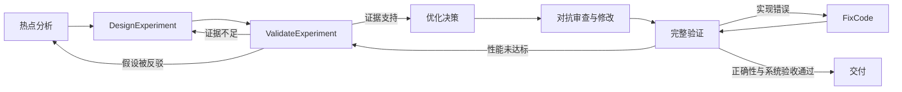

# code-optimizer

鲲鹏/ARM 代码优化插件 — 自动化 C/C++ 性能分析与优化 Pipeline。

同时支持 **Claude Code** 和 **OpenCode** 两种 AI 编码工具。

## 概述

code-optimizer 提供 78 个专业技能（skills），覆盖从热点分析到代码优化的完整 Pipeline：

- **性能分析**: 热点分析、火焰图解析、Top-down 分析、SPE 分析、调用上下文分析
- **优化决策**: 意图解析、任务分解、优化策略决策、架构分析
- **代码优化**: 向量化、汇编优化、循环展开、分支消除、操作融合、预取优化、访存优化
- **平台支持**: Kunpeng-0xd01/0xd03/0xd06 微架构深度优化
- **ARM 指令**: 完整的 ARM 指令集查询（Base/SVE/NEON/SME，共 1527+ 条指令）
- **质量保障**: 对抗性审查、优化验证、修复代码
- **向量数据库与向量检索**：通用 CP0–CP7 优化工作流，按实际目标接入 Faiss、DiskANN 专项流程
- **TF 推理优化**: TensorFlow 纯 CPU 推理优化（图优化 + 自定义 fused kernel + 多维 profiling）
- **CubeSandbox Guest 连接优化**: 快照恢复期间有界预连接、monitor 连接复用和 restore runtime 复用，附原理、独立操作手册、历史补丁与创建总时间配对复现工具

## 诊断反馈流程

通用优化编排新增 **DesignExperiment（假设与实验设计）** 和 **ValidateExperiment（执行实验与反馈）** 两个模板阶段，沿用现有编排和叶子技能。



Agent 在目标环境执行实验并保存原始证据；局部性能结果与最终项目验收分开判断。目标不可用时返回 `awaiting_target_evidence`。

| 验收层次 | 当前状态 |
| --- | --- |
| 本机逻辑与安装测试 | 已通过：30 个顶层测试、两平台各 28 个安装产物测试、8 项既有安装检查 |
| 用户真实历史回放 | pending：尚未提供案例；逻辑 fixture 不算历史回放结果 |
| 鲲鹏实测结果 | pending：尚未提供目标机器及真实实验，尚未完成整体验收 |

复现命令、逐轮揭示证据的方法及真实目标验收清单见 [反馈回放指引](docs/feedback-replay.md)。

## 安装

### OpenCode

```bash
# 克隆 KPBot 仓库
git clone https://gitcode.com/KPBot/KPBot.git

# 安装到你的项目
cd /path/to/your-c-project
/path/to/KPBot/init.sh project opencode

# 启动
opencode
```

安装后 `init.sh` 会自动：
1. 将适用于 OpenCode 的技能安装到 `.opencode/skills/`
2. 生成 `AGENTS.md` 系统提示词

验证安装：

```bash
opencode debug skill | grep optimize   # 确认 skills 已注册
```

### Claude Code

```bash
# 安装 marketplace
claude plugins marketplace add https://gitcode.com/KPBot/KPBot.git

# 或本地安装
claude plugins install --plugin-dir /path/to/KPBot/Plugins/code-optimizer
```

安装后，Claude Code 会根据上下文自动激活相关 skills。

## 技能分类

### 领域分组

`skills/` 顶层仍是平铺 skill；按领域归并的 skill 收在 `skills/<域>/` 下，域目录带 `DOMAIN.md`（范围、成员登记、域内路由、reviewer）。安装时一律展开为 `<tool>/skills/<skill>/`，Claude Code 与 OpenCode 侧的可见性与平铺时完全一致。目录约定见 `docs/STANDARDS.md` 的「领域分组」。

| 领域 | 目录 | 范围 | 当前成员 |
|---|---|---|---|
| 搜推（SRA） | [`skills/sra/`](skills/sra/DOMAIN.md) | 搜推 DAG 全栈优化方法总表 | `sra-dag-tuning` |
| 向量数据库 / 检索 | [`skills/vectordb/`](skills/vectordb/DOMAIN.md) | ANN 索引与向量库（Faiss 子域已并入，DiskANN 陆续并入） | `vsag-rabitq-optimization`、`faiss/`（子域） |
| Agentic Infra | [`skills/agentic-infra/`](skills/agentic-infra/DOMAIN.md) | microVM 沙箱与 AgentENV 的创建路径 | `cubesandbox-create-optimize` |
| 微服务 | [`skills/microservice/`](skills/microservice/DOMAIN.md) | 服务进程性能（改实现侧；配置调优在 app-tuner 同名域） | `go-pprof-analysis` |
| 存储 | [`skills/storage/`](skills/storage/DOMAIN.md) | 块层 / 文件系统 / NVMe / 分布式存储（占位，0 成员） | — |

新增 skill 请登记在所属域的 `DOMAIN.md`，不要改本文件的技能总表，也不要改 `skills/kpbot-code-optimizer/SKILL.md` 的全局路由表——共享行会让并行 PR 必然冲突。

### 分析类 (Analysis)
| 技能 | 描述 |
|------|------|
| `analyze-hotspot` | 热点函数分析 |
| `analyze-architecture` | 代码架构分析 |
| `analyze-caller-context` | 调用上下文分析 |
| `analyze-testcase` | 测试用例分析 |
| `arm-spe-analysis` | ARM SPE (Statistical Profiling Extension) 分析 |
| `gcov-coverage-analysis` | gcov/lcov 覆盖率驱动的性能优化点识别（热点行/冷路径/循环画像/函数调用计数） |
| `register-pressure-analysis` | 寄存器压力分析 |
| `hot-library-version-gap` | 热点库版本差距核对(进程实际加载库与版本 vs 已知含优化的版本，只读诊断) |

### 优化类 (Optimization)
| 技能 | 描述 |
|------|------|
| [cubesandbox-agent-preconnect](skills/cubesandbox-agent-preconnect/SKILL.md) | CubeSandbox Guest 预连接与连接/runtime 复用；自带实施、回退、验证协议和工具，不依赖其他 skill |
| `apply-optimization` | 应用优化方案 |
| `apply-generic-optimization` | 通用优化应用 |
| [cubesandbox-master-create-path](skills/cubesandbox-master-create-path/SKILL.md) | 模板解析 TTL 缓存、同键查询合并与 best-effort spec 异步落库，附一致性、构建部署和独立复现工具；不依赖其他 skill |
| `apply-vectorization` | 向量化优化（NEON/SVE） |
| `asm-optimization` | 汇编级优化 |
| `branch-elimination` | 分支消除 |
| `loop-unrolling` | 循环展开 |
| `operation-fusion` | 操作融合 |
| `prefetch-optimization` | 预取优化 |
| `memory-access-optimization` | 访存优化 |
| [cubesandbox-rootfs-shadow-pool](skills/cubesandbox-rootfs-shadow-pool/SKILL.md) | rootfs 后台预派生、rename 领养与目录合并持久化，附混合构建、生命周期、容量和独立复现工具；不依赖其他 skill |
| `scalar-vector-hybrid` | 标量-向量混合优化 |
| `source-transform-autovec` | 源码变换辅助自动向量化 |
| `precision-transform` | 精度变换优化 |
| `special-case-optimization` | 特例优化 |
| `compiler-flag-tuning` | 编译选项调优 |

### 推理框架优化 (Inference)
| 技能 | 描述 |
|------|------|
| [`ort-kdnn-attention-opt`](skills/ort-kdnn-attention-opt/SKILL.md) | ONNX Runtime + KDNN 的 Attention/MHA 子图识别、融合内核、框架接入、正确性验证与 A/B 基准 |
| [`tf-inference-opt`](skills/tf-inference-opt/SKILL.md) | TensorFlow CPU 推理与 Serving 的图优化、算子库接入、线程调度、序列化与构建调优 |

两个技能共用 canonical 内容，Claude Code 和 OpenCode 均通过 `install.sh` 自动安装。
ORT 技能的模型扫描脚本依赖 Python `onnx` 包；A/B 脚本需已有的 ORT/KDNN benchmark 和模型，
从目标 ORT 源码根目录运行，或用 `REPO_ROOT` 指定该目录。技能内的源码相对路径指向待优化项目；
TF 历史报告中的绝对路径仅用于追溯原实验，不是 KPBot 的运行依赖。

这两个技能可独立调用，尚未接入通用代码优化流水线内部的策略路由。

### 向量数据库与向量检索

`kpbot-code-optimizer` 将检索优化任务交给 [`vector-search-optimize`](skills/vector-search-optimize/SKILL.md)。该入口定义一套 [通用 CP0–CP7](skills/vector-search-optimize/references/cp0-cp7.md)，按实际库和执行层级路由。Faiss、DiskANN、pgvector 复用各自的角色、构建入口和实验状态。其他引擎和数据库服务层可直接使用通用流程。

#### Faiss

Faiss 专项由 [`faiss-optimize`](skills/vectordb/faiss/faiss-optimize/SKILL.md) 编排。

| 技能 | 职责 |
|------|------|
| `faiss-optimize` | CP0–CP7 编排、五角色交接与实验状态管理 |
| `faiss-source-analysis` / `faiss-algorithm-optimization` | 源码取证、算法路由与候选选择 |
| `faiss-build` / `faiss-benchmark-baseline` / `faiss-perf-profile` | 构建清单、冻结基线与性能采样 |
| `faiss-simd-optimization` | 根据实际后端与指令路径选择 SIMD 方案 |
| `faiss-sra-test` | 使用 sra_test 作为可选测试适配器 |
| `faiss-ivfpq-optimization` / `faiss-ivfpqfs-optimization` | IVFPQ 与 FastScan 的数据布局、热点和验证 |
| `faiss-hnsw-optimization` / `faiss-rabitq-optimization` / `faiss-turboquant-optimization` | HNSW、RaBitQ 与 TurboQuant 的算法专项指导 |
| `vector-experiment-methodology` / `vector-ut-st-validation` | 交错性能对照、正确性验证与报告契约 |

安装沿用现有 `install.sh`，同时注册五个 Faiss 角色。运行产物保存在独立目录；算法、版本、数据和资源限制由当前任务决定。

Faiss 技能族收在 [`skills/vectordb/faiss/`](skills/vectordb/faiss/DOMAIN.md) 子域下；完整成员清单与路由见该子域的 `DOMAIN.md`，此处不逐项重复。

#### DiskANN

DiskANN 专项由 [`diskann-optimize`](skills/diskann-optimize/SKILL.md) 编排基线、候选实现和复验。安装器同时注册五个专业子 Agent。

| 技能 | 职责 |
|------|------|
| [`diskann-optimize`](skills/diskann-optimize/SKILL.md) | CP0–CP7 编排和实验状态管理 |
| [`diskann-source-analysis`](skills/diskann-source-analysis/SKILL.md) | 确认版本、索引后端、调用链和瓶颈 |
| [`diskann-benchmark-baseline`](skills/diskann-benchmark-baseline/SKILL.md) | 冻结基线、运行原生基准和采样 |

三个技能复用 `vector-experiment-methodology` 与 `vector-ut-st-validation`。安装和运行方式见 [DiskANN 快速入门](skills/diskann-optimize/quickstart.md)。

#### pgvector

pgvector 专项由 [`pgvector-optimize`](skills/pgvector-optimize/SKILL.md) 编排，覆盖 HNSW/IVFFlat 索引、vector / halfvec / bit / sparsevec 距离内核与精确最近邻。安装器同时注册五个专业子 Agent。

| 技能 | 职责 |
|------|------|
| [`pgvector-optimize`](skills/pgvector-optimize/SKILL.md) | CP0–CP7 编排、五角色交接与实验状态管理 |
| `pgvector-analyzer` / `pgvector-profiler` | 源码取证、性能采样与基线与复验证据 |
| `pgvector-candidate-planner` / `pgvector-implementer` / `pgvector-reviewer` | 候选计划、实现、构建测试与独立验收 |

状态契约 `kpbot-pgvector-opt-run.v1` 由 `init_run` / `validate_state` / `validate_handoff` 校验。复用 `vector-experiment-methodology` 与 `vector-ut-st-validation`，初始化与运行方式见 [pgvector 快速入门](skills/pgvector-optimize/references/quickstart.md)。

### 向量数据库 (Vector DB)
| 技能 | 描述 |
|------|------|
| `vector-db-optimization-migration` | 向量数据库/检索库跨版本优化迁移（引擎中立流程、Faiss/DiskANN 按需路由、资产分型、分层 patch、G0–G5 等价性门禁、同窗 ABBA） |

### Agent 记忆系统与图数据库 (Memory / Graph DB)
| 技能 | 描述 |
|------|------|
| [`agent-memory-db-optimization`](skills/agent-memory-db-optimization/SKILL.md) | Agent 记忆系统/图数据库后端（Graphiti、Neo4j、Zep/Mem0）五阶段优化：冻结确定性 LLM/embedding 负载 → 客户端/驱动/服务端三段归因 → top-down 与缓存缺失率瓶颈建模 → 分层杠杆（载荷瘦身、PackStream 解码下沉、时序水合下沉、读路径多副本扩展、服务端解码快路径）→ 矩阵复测与跨架构对照；门禁为 0 缓存未命中 + 图规模校验和 + 结果逐字节等价。 |

服务端优化对象是 Neo4j 等图数据库的读路径与存储解码，不是向量索引库内部算法：索引库（Faiss/DiskANN/VSAG）内部优化仍走上面的向量检索入口。

### 媒体库优化 (Media)
| 技能 | 描述 |
|------|------|
| [`multimedia-code-optimizer`](skills/multimedia-code-optimizer/SKILL.md) | 面向 Linux AArch64 的媒体计算密集型代码优化，结合领域优化知识与微架构性能建模，改进关键代码片段的实现，提供统一成本评估、独立正确性验证与代码集成能力。 |

支持指定函数、循环或局部代码片段优化，也可依据已有 Top-down／perf 报告确定优化目标。当前适配 Claude Code，可直接调用，或从 `kpbot-code-optimizer` 的“媒体库优化”进入。

### Pipeline 类 (Workflow)

> `cubesandbox-create-optimize` 已归入 [Agentic Infra 域](skills/agentic-infra/DOMAIN.md)，成员与职责见该域 `DOMAIN.md`。
| 技能 | 描述 |
|------|------|
| `kpbot-code-optimizer` | 优化 Pipeline 编排 |
| `kpbot-code-optimizer-workflow` | 优化 Pipeline 工作流 |
| `drive-claude-optimize-pipeline` | 驱动 Claude 执行优化 Pipeline |
| `batch-drive-optimize-pipeline` | 批量驱动优化 Pipeline |
| `interactive-optimizer` | 交互式优化器 |
| `parse-intent` | 意图解析 |
| `decompose-tasks` | 任务分解 |
| `decide-optimization` | 优化策略决策 |
| `gather-context` | 上下文收集 |
| `prepare-project` | 项目准备 |

### 平台知识 (Platform)
| 技能 | 描述 |
|------|------|
| `kunpeng_microarch` | Kunpeng-0xd01/0xd03/0xd06 微架构知识库 |
| `arm-instructions-query` | ARM 指令集查询工具 |

### 质量保障 (Quality)
| 技能 | 描述 |
|------|------|
| `verify-optimization` | 优化验证 |
| `adversarial-review` | 对抗性审查 |
| `fix-code` | 代码修复 |
| `evolve-skill` | 技能演化 |

### TF 推理优化 (TF Inference)
| 技能 | 描述 |
|------|------|
| `tf-inference-optimizer` | TF 推理优化统一工作流（主入口） |
| `tf-env-verify` | 环境验证 |
| `tf-profile-collector` | 多维 profiling（静态图/trace/perf） |
| `tf-graph-optimize` | 图优化（remapper/rewriter） |
| `tf-kernel-optimize` | 自定义 fused kernel |
| `tf-result-verify` | 结果验证与归因 |
| `tf-benchmark` | 端到端基准测试 |

## 使用方式

### 在 OpenCode 中

安装后直接在 OpenCode 中用自然语言描述优化需求：

```
> 帮我优化 src/math/matrix.c 中的 matmul 函数，目标平台 Kunpeng-0xd01
```

```
> 用 NEON 指令向量化这个求和循环
```

```
> 查询 vmlaq_f32 和 vfmaq_f32 的区别
```

主要入口（自然语言描述需求，底层自动调用对应技能）：

| 场景 | 告诉 OpenCode | 底层技能 |
|------|-------------|---------|
| 完整优化流程 | "帮我优化这个项目的性能" | `kpbot-code-optimizer` |
| 逐函数交互优化 | "逐函数分析并优化这个模块" | `interactive-optimizer` |
| 查 ARM 指令 | "查询 vaddq_f32 的用法" | `arm-instructions-query` |
| SPE 采样分析 | "用 ARM SPE 分析缓存 miss" | `arm-spe-analysis` |
| TF 推理优化 | "帮我优化这个 TF 模型的推理性能" | `tf-inference-optimizer` |

### 在 Claude Code 中

安装后，Claude Code 会根据上下文自动激活相关 skills。

## 支持平台

- Kunpeng-0xd01
- Kunpeng-0xd03
- Kunpeng-0xd06
- 通用 AArch64 平台

## License

[Apache-2.0](../../LICENSE)
