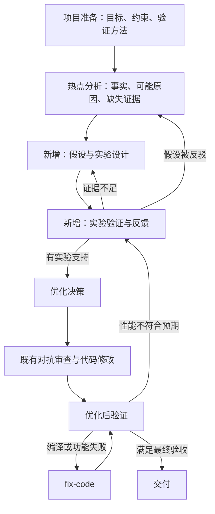

# code-optimizer 密集反馈设计范围

版本：v3，2026-09-18。本文按已确认的讨论更新，替代 v2 中以“用户执行、导入结果”为正式流程的安排。

## 一眼看清修改

| 类型 | 内容 |
| --- | --- |
| 新增环节 | 假设与实验设计（DesignExperiment） |
| 新增环节 | 实验验证与反馈（ValidateExperiment，包含执行和分析） |
| 新增支撑 | 实验记录，保存版本、条件、原始证据和结论 |
| 修改环节 | 项目准备、热点分析、优化决策、优化后验证 |
| 后续项目 | 独立优化方法库，本期不实现 |

全部环节共享实验记录。已有充分且可比的实验也可以用于反馈判断，无须为走流程重复实验。

## 全局约束

- 本期仅修改 code-optimizer，不改 app-tuner 和 TF 专项。
- dotproduct 仅为已有示例，不作为本期测试入口或主要验收案例。
- 不使用、不改造 evolve-skill；优化方法库另立后续计划。
- 正式运行时由 Agent 在目标环境调用实验工具并读取结果；手工提供历史结果仅用于开发和回放。
- 当前开发机器不承担鲲鹏性能验收；本机检查只证明契约、记录和路由正确。
- 局部实验不能替代项目完整正确性与用户约定工作负载的最终验收。
- 保留现有编排与叶子 skills，通过阶段模板和小型辅助脚本接入，不建设新运行时平台。
- 主源与已存在的 OpenCode 覆盖文件保持语义一致。
- 原始证据、模型解释与经实验支持的结论分别记录；采样缺失不能证明未执行，理论估算不能冒充实测。
- 目标环境不可用时返回 awaiting_target_evidence，不在本机用替代性能结果宣告成功。

## 两个新增环节的职责

DesignExperiment：输入当前优化点与分析结果，输出可反驳的假设、替代解释、控制条件、最小实验、支持/反驳判据及预算。下一步实验可以只观察，不必改源码。

ValidateExperiment：确认目标条件，执行已设计的实验或核验已有原始证据，将结果与预先声明的判据对照，返回 supported / refuted / inconclusive / invalid。它负责诊断反馈，不提交优化、不自动修改技能知识。

主编排根据反馈转向；fix-code 负责明确的实现错误，不承担所有性能退化问题。

## 实验记录与预算

每次实验使用不可复用的 experiment_id，并引用 run_id、优化点、假设版本和父代码状态。保存实际源码状态、构建条件、工作负载、目标机器标识、命令、原始结果及结论依据。有未提交代码时不能只记 Git HEAD。

实验动作串行；不自动丢弃用户修改。失败候选与已验收父状态分开记录；不能确认恢复时阻塞后续修改，避免污染对照。

新增诊断循环默认每优化点最多 3 个实验、单个命令默认 600 秒；允许项目准备阶段按实际任务调整。先消耗预算再执行；缺少目标环境不消耗实验额度。预算耗尽记录 stop_budget，不静默重置；无新证据或新变更不原样重复。

## 与 GLM 方法的对应

局部且可归因：执行条件与证据范围关联到具体问题。低成本及时：先选最能区分假设的小实验。客观可验证：判据先于结果，相关性用于提出假设，控制实验用于检验。结果保存为后续方法积累的基础，本期不做自动知识晋升。

## 验收层次

1. 本机：记录与引用校验、异常输入、分支路由、预算和平台安装一致性。
2. 历史回放：逐轮开放用户提供的真实证据，检查是否能修正假设；不提前暴露最终结论。
3. 鲲鹏实测：使用用户提供的真实局部实验及项目验收方法，验证修改和实际收益；环境未提供时明确未完成。

## 开发计划

详细任务见 [Superpowers 修改计划](superpowers/plans/2026-09-18-code-optimizer-dense-feedback.md)。本期实现与本机检查已完成，详见 [实施记录](implementation-results.md)；真实历史回放和鲲鹏实测仍待验收。
