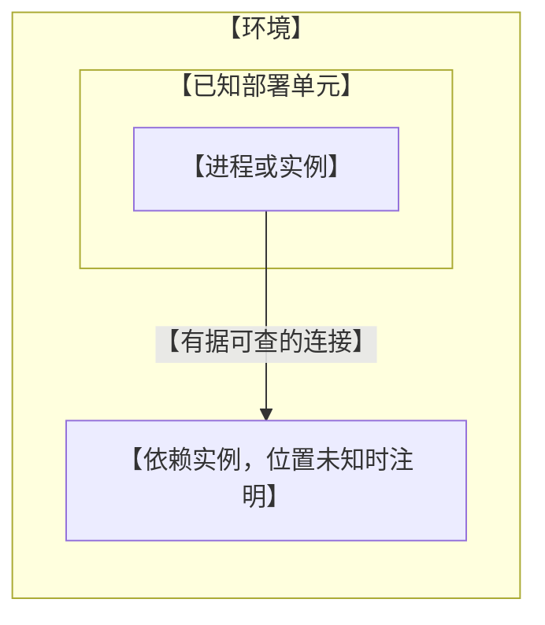
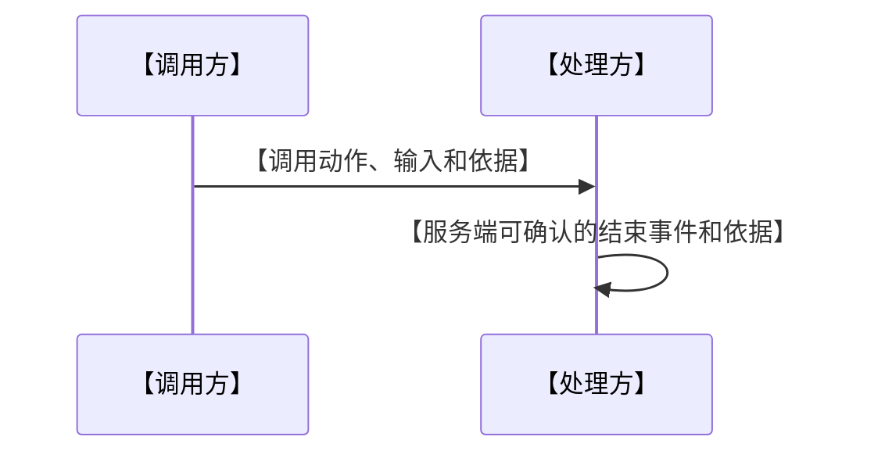

# 【系统或业务名称】场景分析报告

**分析范围**　【业务入口与终点】｜【环境、版本】｜【材料或采样窗口】

<!-- 使用时替换所有【占位内容】，删除编写提示。按要求保留视图；缺少关键材料时写明可确认的边界。图中的节点和箭头均为占位。 -->

## 1. 场景概述

【用一段交代服务对象、触发条件、系统交付的结果和最重要的结论。就近标出支撑结论的证据，如 E1。】

## 2. 业务用例与规则

### 2.1 用例视图

### 2.2 用例与分支

| 用例与触发条件 | 处理规则 | 预期或已验证的结果 | 测试或证据 |
|---|---|---|---|
| UC1【主路径及前置条件】 | 【由哪个组件处理输入】 | 【预期结果，或哪一端实际观测到了什么】 | 【契约、源码、用例或记录编号】 |
| UC1【异常或边界条件】 | 【与主路径的差异】 | 【回退结果或副作用，注明断言位置】 | 【覆盖情况与编号】 |

## 3. 技术视图

### 3.1 逻辑架构

**【业务范围】｜组件与职责**

【指出哪项职责决定业务结果，并标证据。】

### 3.2 部署视图

**【环境及版本】｜【声明布局或运行快照】**

【说明哪些落点或跨边界调用可以确认，依据是什么。】

### 3.3 运行时序

**【环境、代表路径】｜【运行已观察、测试已验证或源码支持】**

【先画共同步骤，再按实际触发条件分支。发生回退时，画出触发事件和返回数据的来源。只有写出记录时画到服务端写出，有收包记录时再画到调用方。混用源码、测试与运行记录时逐步标明依据。】

### 3.4 上下游关系

**【业务路径】｜箭头表示【调用或数据传递方向】**

| 调用或传递方向 | 输入与输出 | 等待边界及失败行为 | 依据 |
|---|---|---|---|
| 【调用方 → 被调方】 | 【请求字段含义 → 返回值含义】 | 【是否阻塞业务返回；失败如何处理】 | 【编号】 |

<!-- 涉及消息、索引或批产物时，按实际链路写生产方、载体、消费方，说明记录覆盖发布、消费还是业务完成。 -->

## 4. 测试方法与指标

### 4.1 测试方法与结果

| 对应业务用例 | 测试方法与输入条件 | 断言或计量方法 | 已有结果与依据 |
|---|---|---|---|
| 【用例编号】 | 【功能测试、异常注入、回放或压测；版本、输入与工况】 | 【核对哪些输出或如何统计】 | 【实测、仅有计划或缺测；证据编号】 |

### 4.2 业务指标

| 指标 | 定义与统计人群 | 结果与依据 |
|---|---|---|
| 【对应业务目标的指标】 | 【成功条件、分子、分母与窗口】 | 【实测值与依据；有验收目标时列出目标并判断是否达标，缺测时注明】 |

### 4.3 系统性能指标

**测量条件**　【环境、版本、请求组合、负载、预热、稳态窗口、样本量；有对照时注明基线】

| 指标 | 测量范围及口径 | 结果与依据 |
|---|---|---|
| 吞吐 | 【压测端发出、观察到终态、成功的请求数及窗口秒数；有服务端接收计数时另列到达率】 | 【各端点的实际 QPS；在终态中列明成功、超时及其他失败数】 |
| 各级时延 | 【端到端、服务端、排队、业务阶段或下游调用的起止事件、筛选条件和各自的有效样本数】 | 【分位数或单笔耗时（ms），对应的记录或分布字段】 |
| CPU 利用率 | 【进程、容器或整机；折算占比时给出同窗核数或配额的取值与来源】 | 【平均用核数或利用率】 |
| DDR 带宽利用率 | 【通道或插槽；读写带宽及同范围参考峰值或实测基准】 | 【读、写 GB/s；分母明确时写占比】 |

<!-- 只保留适用的指标。用户点名但缺测的项目可合并成一句，交代缺少的计数或端点。末尾注明影响解读的限制。 -->

## 5. 证据索引

| 编号 | 材料、版本与位置 | 关键摘录或核验方式 |
|---|---|---|
| E1 | 【文档章节、源码符号、配置键、用例或事件】 | 【足以支持正文结论的脱敏事实】 |
