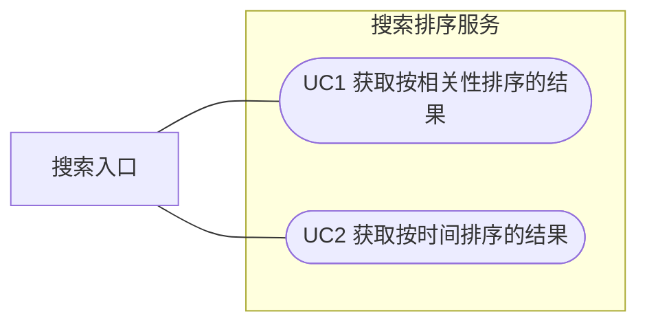
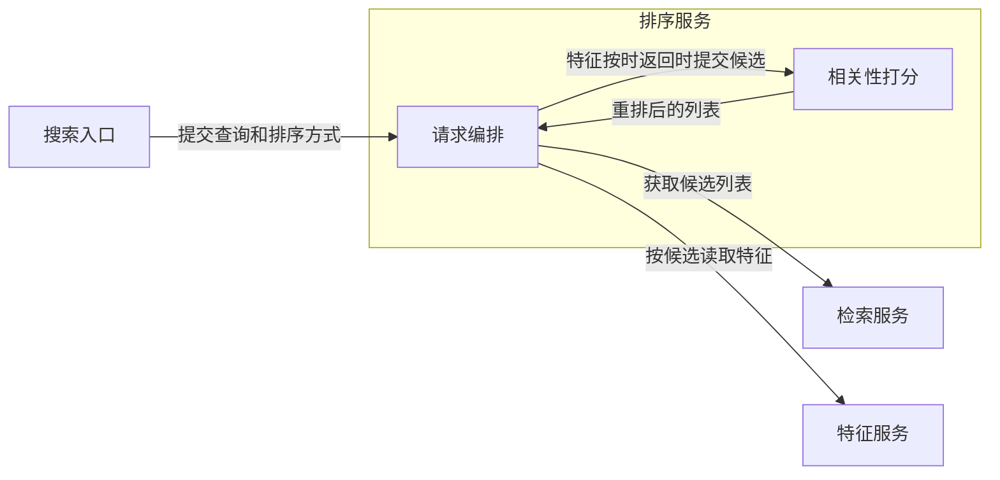
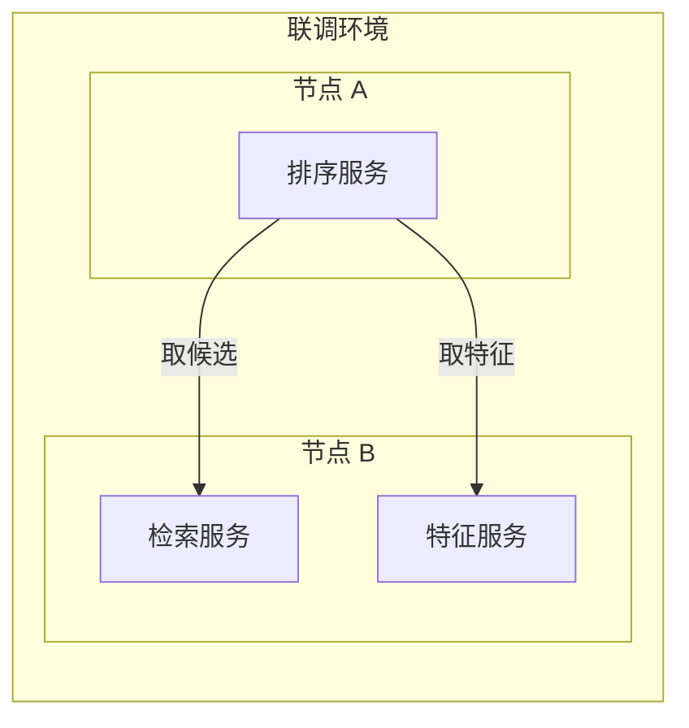
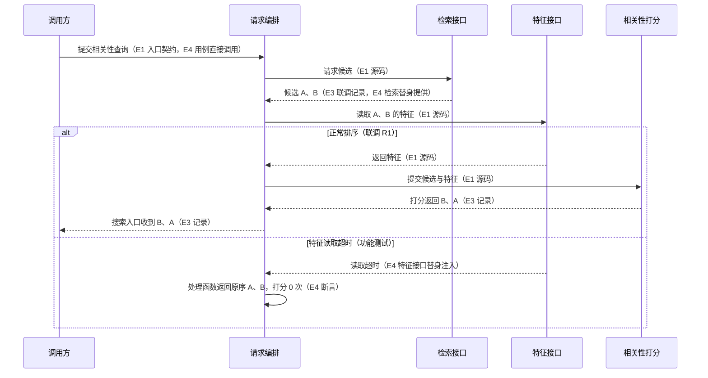
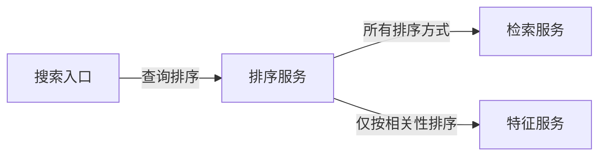

# 搜索结果页排序场景分析报告

**分析范围**　搜索入口提交查询至收到有序条目列表｜联调环境，排序服务 v2.3｜一笔定向请求、两项功能测试和一轮稳态压测。本文的业务、记录和数字均为虚构示例。

## 1. 场景概述

搜索入口支持按相关性和按时间查询。按相关性排序时，排序服务取得检索候选后读取特征并打分。一笔联调请求中，搜索入口收到了重排结果 B、A。功能测试中，特征读取超时后，排序服务按原序返回 A、B。按时间查询时，排序服务直接转交检索结果。依据 E1、E3、E4。

## 2. 业务用例与规则

### 2.1 用例视图

搜索入口调用同一服务完成两种业务目标。特征超时是 UC1 的回退分支。依据 E1。

### 2.2 用例与分支

| 场景与触发条件 | 排序服务的处理规则 | 已验证的结果与观测位置 | 验证情况与证据 |
|---|---|---|---|
| UC1，正常排序 | 收到特征后按分数重排 | R1 的检索候选为 A、B，搜索入口收到 B、A | 处理规则 E1，联调记录 E3 |
| UC1，特征读取超时 | 跳过打分，保留检索顺序 | 测试中排序处理函数返回 A、B，打分次数为 0 | 超时用例 E4 |
| UC2，按时间排序 | 直接转交检索候选 | 测试中排序处理函数返回的条目符合时间顺序，特征读取次数为 0 | 源码 E1，时间排序用例 E4 |

## 3. 技术视图

### 3.1 逻辑架构

**搜索结果页｜候选生成与排序职责**

检索服务决定哪些条目进入候选集。请求编排根据排序方式和特征读取结果，决定是否改变候选顺序。依据 E1。

### 3.2 部署视图

**联调环境 v2.3｜发布清单声明的布局**

发布清单将排序服务与两个下游配置在不同节点。该次请求只记录了服务名，确认实际落点还需同一窗口的实例映射和调用端点。依据 E2、E3。

### 3.3 运行时序

**相关性排序｜正常分支取自联调请求 R1，超时分支取自功能测试**

R1 记录到搜索入口收包。超时用例直接调用排序处理函数，断言止于该函数按原序返回。用例未观测搜索入口收包或实际特征服务的状态。依据 E3、E4。

### 3.4 上下游关系

**搜索结果页｜箭头从调用方指向被调方**

| 调用方向 | 输入与输出 | 等待边界及失败行为 | 依据 |
|---|---|---|---|
| 搜索入口 → 排序服务 | 查询词、排序方式 → 有序列表 | 入口等待响应；入口自身的超时策略待核实 | E1、E3 |
| 排序服务 → 检索服务 | 查询条件 → 候选列表 | 两种排序都等待候选；检索失败时的返回值缺少依据 | E1 |
| 排序服务 → 特征服务 | 候选标识 → 特征值 | 相关性路径等待特征或本地超时；按时间路径跳过此调用 | E1、E4 |

## 4. 测试方法与指标

### 4.1 测试方法与结果

| 业务用例 | 测试方法与输入条件 | 断言或计量方法 | 结果与依据 |
|---|---|---|---|
| UC1 正常排序 | 定向请求使用可重排的候选 A、B | 对照检索返回、打分返回和入口收包三个事件 | 入口收到 B、A，E3 |
| UC1 超时回退 | 测试替身注入特征读取超时 | 同时核对候选顺序和打分次数 | 原序返回且打分 0 次，E4 |
| UC2 时间排序 | 输入两条发布时间不同的候选 | 核对返回顺序和特征服务调用次数 | 时间序正确，特征读取 0 次，E4 |
| UC1 稳态负载 | 压测端模拟搜索入口，直接向排序服务回放相关性查询 | 按逻辑请求统计终态，按阶段统计耗时，资源采样取同一窗口 | 结果见下两节，E5 至 E7 |

### 4.2 业务指标

| 指标 | 定义与统计人群 | 本轮结果 |
|---|---|---|
| 排序回退率 | 成功返回中沿用检索顺序的超时回退数 / 成功返回的相关性查询数 | 120 / 5,940 = 2.02%，E5 |
| 空结果率 | 成功返回空列表数 / 成功返回的相关性查询数 | 30 / 5,940 = 0.51%，E5 |

两项比例描述本轮回放。判断排序相关性还需要带相关性标注的查询集；返回条目数和请求成功率都无法回答这个问题。

### 4.3 系统性能指标

**测量条件**　联调环境 v2.3，相关性查询，热缓存，压测端目标发出速率 100 请求/秒。预热后取 60 秒稳态窗口，6,000 笔逻辑请求均在窗口内发出并在压测端取得终态，无重试。各项耗时均由对应端点的本地时钟计量。依据 E5 至 E7。

| 指标 | 测量范围及口径 | 本轮结果 |
|---|---|---|
| 压测端吞吐 | 发出 6,000 笔。6,000 笔终态中，成功 5,940 笔、客户端超时 60 笔、其他失败 0 笔。各除以 60 秒 | 发出 100、观察到终态 100、成功 99 请求/秒（E5） |
| 端到端、服务端时延 | 同一批成功请求，各 5,940 笔。端到端从压测端发出至收包，服务端从排序服务接收至写出 | 端到端 P50/P95/P99 为 18/30/42 ms，服务端 P99 为 38 ms（E7） |
| 排队、检索时延 | 成功请求中，排队取入队至开始执行，检索取调用至返回。各有 5,940 对起止记录 | 排队 P99 为 3 ms，检索 P99 为 12 ms（E7） |
| 特征读取、打分时延 | 成功且未回退的请求中，特征读取取调用至返回，打分取开始至结束。各有 5,820 对起止记录 | 特征读取 P99 为 16 ms，打分 P99 为 8 ms（E7） |
| CPU 利用率 | 排序服务容器，同窗配额为 4 核，60 秒消耗 180 核秒 | 平均占用 3 核，占配额 75%（E6） |
| DDR 带宽利用率 | 排序节点单插槽全部内存通道，同一范围、相同读写比例下实测可持续总带宽为 80 GB/s | 平均读 30、写 10 GB/s，总带宽占参考值 50%（E6） |

60 笔客户端超时计入终态吞吐，未计入成功请求的时延分布。本轮缺少覆盖所有请求的服务端接收计数，服务端到达率待核实。DDR 数据覆盖整个插槽，其中可能包含其他进程流量。单个负载点只代表该工况。

## 5. 证据索引

| 编号 | 材料、版本与位置 | 关键摘录或核验方式 |
|---|---|---|
| E1 | v2.3 接口说明“排序方式”，排序服务入口 `RankHandler.handle` | 入口接收查询并取检索候选。按时间时直返候选。按相关性时读取特征，成功后打分，超时则返回原列表 |
| E2 | 联调发布清单 v2.3，服务放置配置 | 排序服务 → 节点 A；检索服务、特征服务 → 节点 B。清单只列声明位置 |
| E3 | 联调运行 R1，同一请求的检索返回、打分返回和入口收包事件 | `recall.return=[A,B]` → `rank.scored=[B,A]` → `entry.received=[B,A]` |
| E4 | v2.3 功能测试执行记录，`feature_timeout`、`order_by_time` 均通过 | 两项用例均调用排序处理函数。前者由检索替身提供 A、B，由特征替身注入读取超时，断言函数返回 A、B 且打分 0 次。后者断言结果按时间排列且特征读取 0 次 |
| E5 | 虚构压测汇总 L1，压测端 60 秒稳态窗口的发出、终态与业务计数 | 发出 6,000 笔，成功收包 5,940 笔，超时 60 笔，其他失败 0 笔。成功响应中回退 120 笔、空列表 30 笔 |
| E6 | L1 同窗排序容器的 `cpu.stat`、`cpu.max`，插槽内存控制器计数及带宽基准 | `usage_usec` 增量 180,000,000。同窗 `cpu.max` 固定为 `400000 100000`，配额为 4 核。插槽读 1,800 GB、写 600 GB，参考总带宽 80 GB/s |
| E7 | L1 的 `latency_ms` 分阶段汇总。按请求编号关联压测端终态，每个阶段用成对起止事件计算耗时，读取该行的 `n`、`p50`、`p95`、`p99` | 限成功请求时，`client`、`server`、`queue`、`recall` 各行的 `n` 均为 5,940。再限未回退时，`feature`、`score` 两行的 `n` 各为 5,820 |
